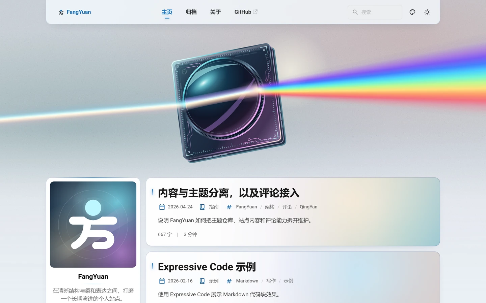
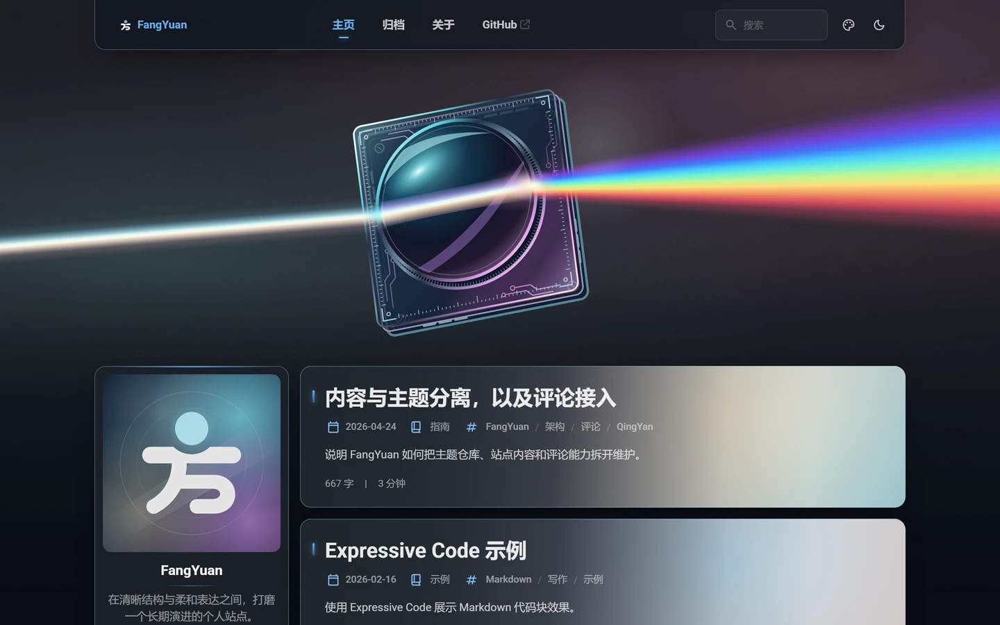
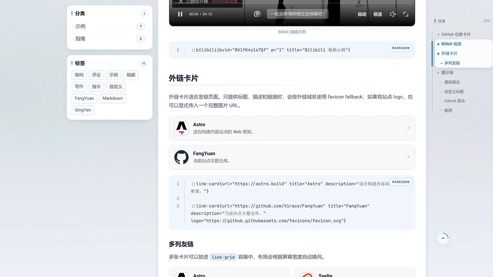
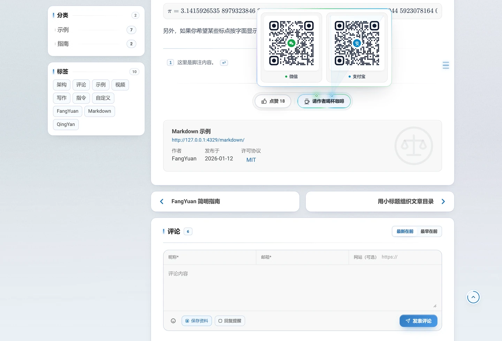

<p align="center">
  
</p>

<h1 align="center">方圆 / FangYuan</h1>

<p align="center">
  基于 Astro 7 的静态个人站点主题，衍生自 <a href="https://github.com/saicaca/fuwari">saicaca/fuwari</a>
</p>

方圆把主题代码和真实站点内容拆开维护：站点配置、文章和图片放到独立目录，主题源码按需更新而不覆盖你的数据。页面上延续了“方与圆”的光学风格，并提供常用的中文写作与站点管理脚手架。

---

## 界面预览

| 首页 · 亮色模式 | 首页 · 暗色模式 |
| :---: | :---: |
|  |  |
| **文章排版 · 光学目录与回顶进度环** | **文章尾声 · 光学打赏投影与 QingYan 评论** |
|  |  |

---

## 主要特点

- **内容与主题分离**：真实站点的 `site.config.yaml`、Markdown 文章和静态图片放在外部目录（默认 `site/`，也可通过 `FANGYUAN_SITE_ROOT` 指定任意路径），升级主题不碰业务数据；配套 `init-site` / `update-site` 与稳定 `contentId` 路由机制。
- **光学视觉与交互动效**：三层方形背板与圆形透镜横幅（可拖动光束、点击脉冲分色，支持 `optics.insert` 嵌标与 `optics.prism` 分光元件）、磨砂玻璃卡片体系、液态光幕 Swup 切页、宽窄双态光学目录与带滚动进度环的回顶按钮；支持明暗模式、动态 `--hue` 调色及自定义导航栏 Logo。
- **中文写作与稳定路由**：基于 Astro 7 + Sätteri，文章与图片可同目录共置；内置提示块、折叠块、高亮、剧透、外链卡片、GitHub 仓库快照卡片、B 站视频、KaTeX 公式、Expressive Code 双主题代码块与 Pagefind 本地搜索；支持自定义永久链接与路径迁移后的历史地址自动跳转。
- **可选的评论与互动**：评论（嵌套回复、表情与按需验证码）、文章点赞、阅读量、光学投影打赏浮层与全局通知队列对接 `QingYan`，未配置或关闭时前端自动隐藏对应区域，保持纯静态站点可用性。

---

## 快速开始

环境要求：Node.js `>= 22.23.4`（开发与 CI 基线见 `.nvmrc` 中的 `26.13.0`）、pnpm `12.18.0`。

### 体验仓库内置示例

```bash
pnpm install --frozen-lockfile
pnpm dev:internal
```

### 初始化并运行自己的站点

```bash
node scripts/site/init-site.js
pnpm dev
pnpm build
```

初始化脚本会生成 `site/site.config.yaml`、`site/content/`、`site/assets/` 以及配套编辑器配置；之后直接维护 `site/` 即可，不要把站点私有数据改回 `src/`。已有站点升级可使用 `node scripts/site/update-site.js`。

### 常用命令

| 命令 | 说明 |
| --- | --- |
| `pnpm dev` / `pnpm build` | 默认模式开发预览与构建（自动选择外部 `site/` 或内置示例） |
| `pnpm dev:internal` / `pnpm build:internal` | 强制使用仓库内置示例运行或构建 |
| `pnpm dev:external` / `pnpm build:external` | 强制使用外部站点目录运行或构建 |
| `pnpm check` | 运行 Astro 页面、路由与内容集合检查 |
| `pnpm test` | 运行快速 Node 单元测试 |
| `pnpm test:system` | 依次运行 Node 测试、构建矩阵与 Playwright 核心回归 |

---

## 文档导航

| 文档 | 内容 |
| --- | --- |
| [外部站点初始化与升级](docs/init-site.md) | `init-site` / `update-site` 命令参数与生成目录说明 |
| [站点配置说明](docs/site-config.md) | `site.config.yaml` 全量配置项与 [光学横幅分层配置](docs/site-config.md#siteconfigbanneropticsprism) |
| [Markdown 扩展语法](docs/markdown-extensions.md) | 指令写法、代码块增强、卡片与图文路径规则 |
| [稳定身份与历史地址](docs/content-routes.md) | `contentId` 登记、改链接保留旧地址跳转与恢复流程 |
| [全局通知](docs/notifications.md) | 站点通知调用、队列与样式边界 |
| [脚本目录](docs/scripts.md) | `scripts/` 下站点、内容与 QingYan 脚本清单 |

---

## 图片与目录分工

- **文章配图与封面**：放在文章同目录或子目录中，Markdown 用相对路径引用（例如 `./inline.svg`、`./cover.webp`）。封面最适配 **`1200 × 600`**（`2:1`，高清 `1600 × 800`）或常见 **`1280 × 720`**（`16:9`），构图居中或略偏右；不填封面时列表卡片自动使用纯 CSS 光学渐变背景，零图片开销。
- **外部站点共享图片**：放在 `<siteRoot>/assets/`，在配置或 frontmatter 中写成 `assets/...`；未被引用的占位图不会进入 `dist/`。
- **主题默认资源与固定图标**：内置示例图放在 `src/assets/`，主题固定光学素材放在 `src/theme-assets/`。
- **远程链接**：`https://...` 图片地址原样透传，构建时不下载打包。

---

## 致谢与许可

感谢上游项目 [saicaca/fuwari](https://github.com/saicaca/fuwari) 提供了最初的页面结构与视觉基础。  
本项目以 [MIT License](LICENSE) 开源。
